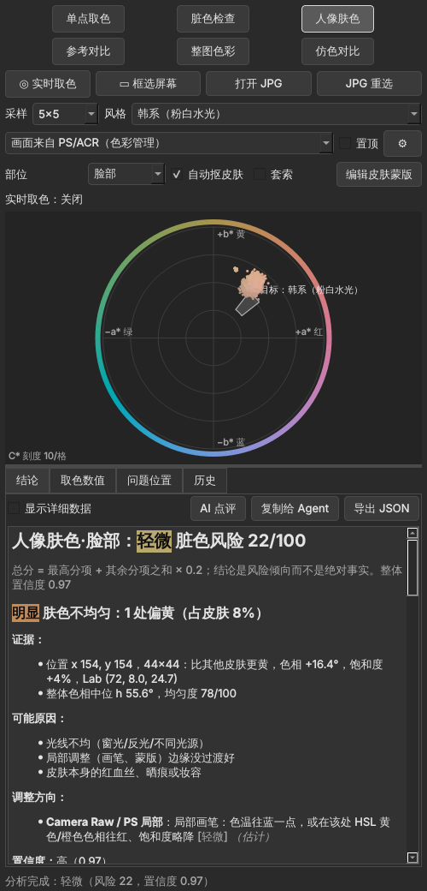

# 人像色彩诊断取色器（ColorDoctor）

给人像摄影师用的**辅助取色器 + 色轮 + 颜色诊断工具**。它悬浮在 Photoshop / Camera Raw 旁边，直接从屏幕（或 JPG 文件）取样，回答下面这些问题：

| 你想知道的 | 用哪个模式 | 工具给你什么 |
|---|---|---|
| 这个点是什么颜色？ | 单点取色 | 显示 HEX、RGB、HSB、HSL、**Lab（D50，与 PS 信息面板一致）**、LCh、OKLab；取样大小 1×1～101×101，与 PS 吸管一致 |
| 颜色哪里脏、哪里发灰？ | 脏色检查 | 检测对立色混入（例如蓝里混黄）和局部发灰，**在图上标出位置** |
| 人物肤色怎么样？ | 人像肤色 | 见下方说明 |
| 和我要的风格差多少？ | 人像肤色 / 整图色彩 | 肤色风格 12 种，整图风格 28 种（青橙、黑金、粉蓝、法式、莫兰迪等，以及富士 / 柯达经典胶片的观感）；给出具体差距和调整方法 |
| 整张图的颜色比例、统一度、有没有缺色？ | 整图色彩 | 6:3:1 比例、色彩丰富度（缺色）、某种颜色是否统一（例如“所有绿色是不是一种绿”） |
| 照着一张参考作品调，差多少、合不合适？ | 仿色对比 | 影调曲线点、整体偏色、阴影/高光色调、混色器各通道、主色对应、适合度判断 |
| 两块皮肤哪里不一样？ | 参考对比 | ΔE00 / ΔL* / ΔC* / Δh 等差异，以及把问题区拉回参考区的调整方法 |
| 怎么调？ | 所有模式 | 给出 ACR（基本、混色器、颜色分级、校准）和 PS（曲线、色彩平衡、色相/饱和度、可选颜色）的方向与参数；可以再让 AI 点评 |

**“人像肤色”模式具体包括：**

- **快速判定**：按你的经验规则判断肤色是否健康（a\*、b\* 在 10–20 之间，且相差不超过 5）；
- **偏色**：整体偏红、偏黄、偏绿、偏洋红；
- **局部问题**：高光发黄、阴影发青；
- **杂色**：皮肤里混进的紫、青、绿色；
- **缺色发灰**；
- **均匀度**：标出“一块偏橙、一块偏黄”这类不均匀的位置；
- **脸部 vs 身体**：两个部位的肤色差异。

> **只分析，不修改图片。** 所有计算都在本机完成。AI 点评是**可选**功能，默认关闭；只有在设置中开启并点击“AI 点评”时，才会把数值（以及你勾选时的缩略图）发给你选择的 AI。



---

## 安装与运行（Windows）

**方式一：运行打包好的程序**

`dist\ColorDoctor\ColorDoctor.exe`，可以用 `packaging\build_windows.bat` 生成。

**方式二：从源码运行**（需要 Python 3.11 及以上，推荐 3.13）

```bat
py -3.13 -m venv .venv
.venv\Scripts\activate
pip install -r requirements-dev.txt
pip install -e .
python -m colordoctor
```

- 想用 Claude API 做 AI 点评，需要额外运行 `pip install anthropic`。用 Claude Code 会话、Codex 会话或 DeepSeek 不需要安装额外的包。
- 运行测试：`python -m pytest -q`。

---

## 使用方法

窗口顶部有 6 个模式。取样方式有三种：

- **实时取色**：鼠标在 PS 画面上移动，工具实时显示颜色；按 **Ctrl+Alt+Shift+Z** 锁定当前读数。
- **框选屏幕**：按 **Ctrl+Alt+Shift+X**，先冻结所有屏幕，然后单击取点或拖动框选；人像肤色模式下还可以用套索圈选。
- **打开图片**：直接读取 JPG / PNG / TIFF / WebP / 相机 RAW 文件，最精确。

### 人像肤色：精准选中皮肤

- **自动抠皮肤**：默认开启。在你框选的区域里，只统计皮肤像素，自动去掉头发、眉眼、嘴唇和背景。适用于深色到冷白的各种肤色。
- **套索**：勾选后，用自由套索圈出皮肤，而不是矩形框选。
- **编辑皮肤蒙版**：自动抠出的皮肤多了或少了时使用。工具有画笔添加/擦除、魔棒添加/删除、撤销、恢复为自动结果；红色部分表示不计入皮肤。
- **部位**：选“脸部”“身体”等。分别分析脸部和身体后，工具会自动比较两者的肤色差异，并给出把一边拉向另一边的调整方法。
- **问题位置**：这一页会用编号框标出肤色不均匀的位置（偏黄、偏红橙、偏青绿、缺色发灰、饱和度偏高）、杂色像素和发灰位置。

### 整图色彩

框选整张照片。影调和颜色分开选，互不绑定（港风可以配青橙，也可以配黑金）：

- **影调**：先说明这张图现在是九种影调里的哪一种（高 / 中 / 低调 × 长 / 中 / 短调，按 PS 明度直方图判断，只描述、不评判），并画出九宫格和直方图。
- **影调风格**（可选）：预制的目标影调——日系（高短调）、韩系（高中调）、白亮通透（高长调）、Cos（高长调）、森系（中中调）、法式（中中调）、胶片（中短调）、电影感（中长调）、港风（低中调）、暗调情绪（低长调），也可以直接选九种影调之一。每个选项都说明“看起来是什么样、常用在哪”，并列出各影调风格离这张图有多远（已经符合 / 稍改就到 / 变化较大）。选了以后按直方图匹配生成一条曲线图层，往离现在最近的可接受影调走（一次每个点最多 45 级，变化很大时提示回 RAW 调曝光）。不选就不改明暗——工具不替你判断“刻意的暗调还是欠曝”。
- **颜色**（可选）：颜色模板只管颜色（色区、丰富度、阴影 / 高光色调），不再带黑位、对比、提亮；会提示它常配的影调风格。也可以选择要检查的颜色（“统一：绿”）。

- **色彩丰富度**：使用 Hasler-Süsstrunk 指标，按国际通用的分级判断是否缺色、发灰。
- **6:3:1**：分析主色、辅色、点缀色各占多少，并检查颜色是否太杂。
- **某种颜色是否统一**：例如画面里所有的绿色，算出它们的色相离散程度，标出不统一的位置，并告诉你混色器里哪几个通道的色相往哪边收拢。
- **颜色模板**：给出目标色区所占比例、目标之外的颜色、阴影和高光的色调，以及对应的混色器、颜色分级建议和常用做法（校准面板等）。明暗、反差、黑位由「影调风格」管。

### 仿色对比

先框选参考作品（屏幕上的任意图片，或打开参考 JPG），再框选你的照片。工具会给出：

- 相似度；
- 影调曲线点（对明度分位数是精确的）；
- 色温/色调方向；
- 阴影/高光的颜色分级；
- 混色器各通道的建议；
- 参考主色在你的图里有没有对应的颜色；
- **合不合适照着调**：例如影调差异太大、参考的主色在你的画面里根本不存在时，会提醒你。

### AI 点评与 Agent

| 方式 | 说明 |
|---|---|
| **复制给 Agent**（按钮） | 复制提示词和数值，粘贴到 Claude、Codex、WorkBuddy 等任意 AI 会话 |
| **本机 Claude Code 会话** | 调用你已登录的 `claude -p`，不需要在本工具里保存 Key |
| **本机 Codex 会话** | 调用你已登录的 `codex exec` |
| **DeepSeek API** | 只发送文字 |
| **Claude API** | 使用官方 SDK，模型 `claude-opus-5-5`；可以附缩略图，拒答时会自动换模型重试（服务端 fallback） |
| **命令行**（Agent 直接调用） | 见下方示例 |

命令行示例：

```bat
colordoctor analyze photo.jpg --mode skin --rect 820,400,300,260 --preset korean --part 脸部 --summary
colordoctor analyze photo.jpg --mode palette --style teal_orange --family 绿 --json
colordoctor analyze photo.jpg --mode reference --reference ref.jpg --summary
colordoctor analyze photo.jpg --mode point --point 1200,800 --size 5
colordoctor presets      （列出肤色风格）
colordoctor styles       （列出整图风格）
```

`--json` 输出完整结果，`--summary` 输出给 AI 用的精简摘要。输出中不包含任何像素数据。

---

## Lab 怎么看 & 你的快速判定规则

**Lab 的三个值：**

- **L\***：明度，0 是黑，100 是白；
- **a\***：绿（−）↔ 红（+）；
- **b\***：蓝（−）↔ 黄（+）。

**快速判定（默认，就是你的经验规则）：**

- 规则：a\* 和 b\* 都在 10–20 之间，并且 |a\* − b\*| ≤ 5，就判为“正常肤色”（没选肤色风格时用这条；选了风格就用该风格自己的规则，例如“自然通用”允许 b\* 比 a\* 大到 9）；
- 不满足时，会提示是哪一项超了、该往哪边调；
- 同时给出皮肤像素中满足规则的比例。

**不同风格有自己的区间：**

- 法式、小麦、深肤色等风格的 b\* 本来就会更高；
- 可以在 `skin_presets.json` 的 `quick_rule` 中修改全局规则，或修改某个风格自己的区间。

---

## 色彩管理：为什么用显示器 ICC，而不是直接按 sRGB 读屏幕

所有结果都用**标准 sRGB 数值**和 **Lab D50**（与 Photoshop 信息面板一致）表示。

- **问题在哪**：Photoshop 显示图片前，会先按“显示器 ICC 配置文件”转换颜色，所以屏幕上的像素值和文档里的数值不一样。如果直接把屏幕像素当成 sRGB，同一张图在不同显示器上会读出不同的 Lab。在模拟的 P3 广色域屏上实测，肤色误差约为 ΔE00 2.5，而且读数偏灰。
- **工具怎么做**：读取 Windows 当前显示器的配置文件（Photoshop 用的也是这一个），把这次转换反推回去，得到与设备无关的数值。实测平均误差约为 ΔE00 0.1。所以 ICC 在这里的作用是**消除**设备差异。
- **不做色彩管理的软件**：屏幕像素就是文件数值，这时请在下拉框中选“未做色彩管理的软件”，工具会原样读取。
- **最精确的方式**：直接打开 JPG。工具会读取内嵌的 ICC 并转换到 sRGB；原图只读，不写回。

---

## 肤色风格参考（12 种，Lab D50，脸部中间调）

| 风格 | 中心 Lab | 中心色 | HSB | 快速判定区间 | 特点 |
|---|---|---|---|---|---|
| 自然通用 | (68, 14.0, 19.0) | #C79C84 | H21° S34% B78% | a 10–18，b 13–24，差 ≤9 | 健康自然：b\* 略大于 a\*，不红不黄 |
| 日系（通透/清透） | (78, 10.5, 12.0) | #DBBAAB | H19° S22% B86% | a 8–15，b 8–16，差 ≤5 | 明度高、黄色少、色度低，偏粉白或微冷 |
| 韩系（粉白水光） | (80, 12.5, 12.0) | #E4BEB1 | H15° S22% B89% | a 9–16，b 8–16，差 ≤5 | 高亮、偏粉、有血色和水光感 |
| 法式（暖调奶油/胶片） | (69, 13.5, 22.0) | #CA9F81 | H25° S36% B79% | a 10–18，b 14–26，差 ≤9 | 偏暖偏金的奶油肤色，对比柔和 |
| 欧美（暖调/健康） | (65, 14.5, 21.0) | #C09479 | H23° S37% B75% | a 10–19，b 14–25，差 ≤8 | 偏暖、对比强、饱满有光泽 |
| 港风/复古胶片 | (62, 14.5, 22.5) | #B78B6D | H24° S40% B72% | a 10–19，b 15–27，差 ≤10 | 暖、偏黄红，带胶片感 |
| 新中式/古风 | (73, 11.5, 16.5) | #D0AB96 | H22° S28% B82% | a 8–15，b 11–20，差 ≤6 | 干净的象牙白、低饱和 |
| 小麦色（健康麦色） | (58, 14.5, 22.0) | #AD8266 | H24° S41% B68% | a 11–19，b 16–27，差 ≤10 | 比白皮肤暗、暖，有光泽（不是暗黄） |
| 古铜/美黑 | (48, 15.5, 22.0) | #93684E | H23° S47% B58% | a 11–20，b 15–27，差 ≤10 | 暖棕、色度饱满、高光有金属光泽 |
| 深肤色（黑皮） | (35, 12.0, 12.5) | #694B3F | H17° S40% B41% | a 8–16，b 8–17，差 ≤6 | 保持暖意和光泽，不发灰、不发紫 |
| 暗调（情绪/低调） | (50, 12.0, 15.0) | #916F5E | H20° S35% B57% | a 10–20，b 10–20，差 ≤5 | 明度低但干净，阴影不发青 |
| Cos（冷白/瓷白） | (85, 8.5, 8.0) | #E9CEC6 | H14° S15% B91% | a 5–12，b 4–12，差 ≤5 | 高明度、低黄、略带粉 |

**数值来源：**

- **皮肤色度学**：皮肤色相角约 45°–78°。深肤色测量样例：很深的皮肤约为 Lab(27, 12, 12)，深色皮肤约为 Lab(38, 11, 14)。用 ITA 角度标注肤色深浅。
- **修图经验**：a\*、b\* 都为正，并且大致接近；“通透”的常见做法是降低橙色饱和度、提高明亮度；深肤色要避免发灰（ashy）和偏洋红，做青色阴影时要保护皮肤的暖意。
- **定位**：这些数值是**起点，不是标准**。你可以在 ⚙ 设置中打开预设文件夹修改，或在历史中右键选择“用它的肤色作为目标风格”。

## 整图颜色模板（28 种，只管颜色）

### 色彩风格（8 种）

| 风格 | 目标色区（Lab 色相角） | 核心做法 |
|---|---|---|
| 青橙 | 橙 38–82°、青 185–240° | 校准：蓝原色色相 −50～−100、红原色 +20～+50；混色器：冷色往青、暖色往橙，绿/紫降饱和；颜色分级：阴影 180–230、高光 25–45 |
| 黑金 | 金 55–100° | 混色器：红、橙往右，黄往左，统一成金色；冷色饱和度 −60～−100 并压暗；曲线压深黑位 |
| 粉蓝 | 粉 345–35°、蓝 228–290° | 黄、绿降饱和；浅绿、紫往蓝，洋红往红；颜色分级：高光 340–360（粉）、阴影 210–230（蓝） |
| 莫兰迪/低饱和 | 不限 | 全部降饱和（橙色少降，保护肤色），抬黑场降对比 |
| 日系清新 | 肤色 35–70°、青蓝 180–260° | 绿往青，黄降饱和，整体提亮，阴影带青 |
| 胶片暖调 | 暖 40–95°、橄榄绿、青蓝 | 绿往黄（橄榄），蓝往青，高光暖、阴影青，褪色曲线 |
| 森系 | 黄绿 95–150°、肤色 | 绿统一成柔和的黄绿，蓝/紫降饱和 |
| 法式 | 暖 30–95°、橄榄绿 95–140° | 暖调低对比：绿往橄榄，冷色降饱和，高光米黄，黑场抬起 |

### 富士胶片（11 种）与柯达胶片（9 种）

| 系列 | 包含 | 检查什么 |
|---|---|---|
| 富士 | Provia、Velvia、Astia、Classic Chrome、Classic Neg、Pro Neg. Std、Eterna、Eterna 漂白、Nostalgic Neg、Reala Ace、Acros 黑白 | 色彩丰富度、亮暗差（对比）、黑场、阴影/高光色调、指定颜色的去向 |
| 柯达 | Portra 160 / 400 / 800、Ektar 100、Gold 200、UltraMax 400、Ektachrome E100、Kodachrome 64、ColorPlus 200 | 同上；Portra 等负片会检查黑场是否抬起、对比是否够柔 |

- **依据**：根据厂商公开描述和评测文章整理的“观感近似”，每个模板的 `basis` 字段写明依据。**不是厂商算法**，也不模拟颗粒和光谱。Kodachrome 64 已停产，只有常见印象，没有可测量的标准。
- **富士 RAW**：在 ACR 的“配置文件 → 相机匹配”里直接选同名的胶片模拟，比手动调整更准。

- **模板文件**：`src/colordoctor/data/grading_styles.json`，可以修改或新增。
- **估算方法**：滑块数值是按“色相滑块 ±100 ≈ ±30°”等经验关系换算的，请先按方向调整，再重新分析看差距。

---

## 调整建议的精度

| 工具 | 精度 |
|---|---|
| 曲线（肤色平均色、阴影/高光平均色、仿色影调分位数） | **精确**（针对该平均色或分位数） |
| 色彩平衡、色相/饱和度 | 模型估算 |
| 混色器、颜色分级、校准滑块数值 | 估算（Adobe 没有公开算法） |
| 可选颜色 | 只给方向和起步值 |
| Camera Raw 色温/色调 | 只给方向和强度 |

建议的工作方式：按建议调一轮 → 重新取样或分析 → 看剩余差距 → 再微调。

---

## 快捷键

| 快捷键 | 作用 |
|---|---|
| Ctrl+Alt+Shift+Z | 锁定实时取色读数（全局） |
| Ctrl+Alt+Shift+X | 冻结屏幕并框选（全局） |
| `[` / `]` | 在框选层中切换取样大小 |
| Ctrl+O | 打开图片 |
| Esc | 取消框选 |
| Ctrl+Z | 蒙版编辑中撤销 |

---

## Photoshop 插件（开发中）

- `photoshop-plugin/` 是 PS（最新 Beta）的 UXP 面板。功能：
  - 「分析当前图层」，只在手动点击时才分析；调整图层和空白图层会被拦下。
  - 每条问题可以单独生成调整图层并自动加蒙版，也可以一键生成全部。
  - ACR 参数可以修改，并导出 .xmp 预设。
- 分析由本机服务完成：`colordoctor serve`，或打开桌面版时自动启动。服务只监听 127.0.0.1，不联网。
- 支持读取相机 RAW（`pip install rawpy`）。
- AI 抠皮肤：MediaPipe 多类人像分割，需要 `pip install onnxruntime`（Windows 显卡加速装 `onnxruntime-directml`）和模型文件，脸和身体分开抠。
- 安装和尚未在真实 PS 上验证的项目，见 `photoshop-plugin/README.md` 和 `docs/STAGE6_HANDOFF.md`。

## 测试

`python -m pytest -q`，目前共 774 个测试（其中 1 个需要真实模型，默认跳过；插件 JS 测试需要 Node.js），覆盖以下方面：

- **色彩换算**：使用 ΔE00 的 Sharma 标准数据校验。
- **色彩管理**：sRGB、无 ICC、Adobe RGB、P3 显示器。
- **脏色检测与误报专项**。
- **肤色**：精准抠皮肤（头发、嘴唇、眼睛、背景，以及深/中/浅三种肤色）、蒙版编辑、快速判定、均匀度定位、脸部与身体对比。
- **整图色彩**：6:3:1、颜色统一、风格模板、仿色。
- **其他**：命令行、AI（用本地假服务和假命令测试，不联网）、界面交互、离线与只读检查、大图性能。

## 已知限制

- 肤色风格区间、风格模板和诊断阈值都是经验值，**尚未用真实样片校准**。
- 默认的抠皮肤基于颜色规则：与皮肤颜色非常接近的木头、沙发等可能被误选，可以用“编辑皮肤蒙版”修正。装了 `onnxruntime` 和模型时可以勾选“AI 抠皮肤”（MediaPipe 多类人像分割），脸和身体分开，误选少很多。
- Windows 专属部分只能在 Windows 上验证，见 `docs/WINDOWS_HANDOFF.md`：显示器 ICC、全局快捷键、多显示器，以及 `claude -p` / `codex exec` 的实际调用参数。
- 文件可读 JPG、PNG、TIFF、WebP（16 位按 8 位分析；16 位彩色 TIFF 需另存为 8 位）和相机 RAW（RAW 需要 `rawpy`）。RAW 由 LibRaw 解码，颜色与 ACR 的相机配置文件不同，数值只作参考；要与 ACR 一致，请在 PS 插件里分析。PSD 请在 PS 里打开后用插件或屏幕取色分析。
- 单点模式下可以连续点多个点（回车或 Esc 结束），两个点以上自动做“多点对比”：以第一个点为基准，用“几乎看不出 / 仔细对比才看得出 / 能看出 / 明显 / 很明显 / 差别很大”说明差别和偏向（偏黄、偏暗…），并给出一句结论；也可以在历史里多选取色点后右键对比。
- 整图色彩的「影调风格」和「颜色」分开选，见上文“整图色彩”。命令行用 `--tone-style japanese|korean|bright|cos|forest|french|film|cinematic|hongkong|moody` 或 `--tone-target 高中调`，`colordoctor tones` 列出全部说明。
- 界面上的选择（模式、取样大小、肤色目标、部位、套索、整图扫描、影调风格、颜色、统一色、置顶、窗口位置等）会自动保存，下次启动恢复。
- “AI 点评”的 API Key 以明文保存在本机设置（Windows 注册表 `HKCU\Software\ColorDoctor`）里；介意的话留空，改用环境变量 `DEEPSEEK_API_KEY` / `ANTHROPIC_API_KEY`。

## 致谢

本项目的屏幕取色交互参考了 [RNV Color Picker](https://github.com/RNVizion/rnv-color-picker)（MIT）的思路，代码为独立重写，详见 `THIRD_PARTY_NOTICES.md`。
