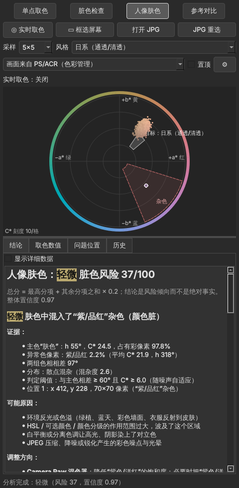

# 人像色彩诊断取色器（ColorDoctor）

给人像摄影师用的**辅助取色器 + 色轮 + 颜色诊断工具**。它悬浮在 Photoshop / Camera Raw 旁边，直接从屏幕（或 JPG 文件）取样，回答三个问题：

1. **这张照片调完色后，哪里颜色脏、发灰？**
   例如：蓝色里混进了黄色；人物橙色的肤色里混进了紫色、青色。工具会**标出具体位置**，并给出数值证据。
2. **这个点 / 这块区域的颜色值是多少？**
   包括 HEX、RGB、HSB（Photoshop 拾色器）、HSL、Lab（D50，与 Photoshop 信息面板一致）、LCh、OKLab、OKLCH 和相对亮度。
3. **离我要的肤色风格（日系、法式、暗调、Cos、自然）还差多少？怎么调？**
   给出 Photoshop 曲线、色彩平衡、色相/饱和度、可选颜色的参数或方向，以及 Camera Raw 的调整方向。

> **只分析，不修改图片。** 所有计算在本机完成，不联网、不上传。



---

## 安装与运行（Windows）

**方式一：直接运行打包好的程序**

`dist\ColorDoctor\ColorDoctor.exe`，可以用 `packaging\build_windows.bat` 生成；GitHub Actions 每次推送也会自动构建，产物名为 `ColorDoctor-windows`。

**方式二：从源码运行**（需要 Python 3.11 及以上，推荐 3.13）

```bat
py -3.13 -m venv .venv
.venv\Scripts\activate
pip install -r requirements-dev.txt
pip install -e .
python -m colordoctor
```

运行测试：`python -m pytest -q`

打包：`packaging\build_windows.bat`。它会依次运行测试、打包，并对打包结果做自检。

---

## 使用方法

窗口顶部有四个模式；取样方式有“实时取色”“框选屏幕”和“打开 JPG”三种。

| 模式 | 怎么用 | 得到什么 |
|---|---|---|
| **单点取色** | 打开“实时取色”，把鼠标移到 Photoshop 画面上，按 **Ctrl+Alt+Shift+Z** 锁定读数；或者点“框选屏幕”后单击 | 全部颜色数值、色轮位置、与目标风格的差距和调整参数 |
| **脏色检查** | “框选屏幕”（**Ctrl+Alt+Shift+X**），框选一块颜色，例如衣服或背景。框选整张照片时勾选“整图扫描” | 是否混入对立色、是否局部发灰；“问题位置”页高亮杂色像素并编号 |
| **人像肤色** | 框选皮肤（脸颊、额头），选择“风格” | 偏红/黄/绿/洋红，高光发黄、阴影发青，杂色（紫、青、绿），发灰，与风格的差距和调整参数 |
| **参考对比** | 先框选**参考区**（干净的皮肤），再框选**问题区** | ΔE00、ΔL*、ΔC*、Δh、Δa*、Δb*，以及把问题区拉回参考区的调整参数 |

其他用法：

- **历史**页：右键某条记录，可以设为参考区、和参考区对比，或者“用它的肤色作为目标风格”（从你喜欢的作品中取样生成目标）。
- **问题位置**页：杂色像素用对比色高亮，发灰处用白色覆盖，其余区域压暗；滚轮缩放，右键拖动平移。
- **采样大小**：1×1、3×3、**5×5（默认）**、9×9、15×15，与 Photoshop 吸管的“N×N 平均”算法一致。
- **置顶**：勾选后窗口始终浮在 Photoshop 上面。

### 结论怎么读

每条结论都按下面的结构给出：

**问题 → 证据（带数值）→ 可能原因 → 调整方向 → 置信度 → 注意事项**

“脏色风险”总分为 0～100，并且**同时显示 7 个分项**：对立色混入、色相离散、色度压缩（发灰）、局部偏色、明度压缩、异常色比例、肤色整体偏色。

总分 = 最高分项 + 其余分项之和 × 0.2（上限 100）。

严重程度分为：正常、轻微、明显、较强。结论表示风险倾向，不是绝对事实。

### 不会误报的情况

下面几种情况都有专门的测试保证：

- 整片低饱和（例如灰蓝）**不等于**脏；
- 暗调**不等于**脏；
- 暖色调（例如法式肤色）**不等于**偏黄；
- 青橙配色、两种颜色各占一半，判定为**配色**，不算污染；
- 少量零散噪点最多判为“轻微”；
- 同一种颜色随明暗变化（阴影变暗、高光变淡）**不算**发灰。

---

## 色彩管理：为什么用显示器 ICC，而不是直接按 sRGB 读屏幕

所有结果都用**标准 sRGB 数值**和 **Lab D50**（与 Photoshop 信息面板一致）表示。问题在于：怎样从屏幕上的像素得到文档里的真实数值。

- Photoshop 和 Camera Raw 是**做色彩管理的软件**：它们先把文档颜色按“显示器 ICC 配置文件”转换，再显示到屏幕上。所以**屏幕上的像素值 ≠ 文档里的数值**。同一张图，在广色域屏或校色过的屏上，屏幕像素会不一样。
- 如果把屏幕像素直接当作 sRGB，**同一张图在不同显示器上会读出不同的 Lab**。在模拟的 P3 广色域屏上实测：肤色误差约为 ΔE00 2.5，而且读数偏灰，会误导“发灰”判断。
- 本工具读取 Windows 当前显示器的 ICC 配置文件（Photoshop 用的也是这一个），**把转换反推回去**，得到与设备无关的 sRGB 数值。实测平均误差约为 ΔE00 0.1。所以，**ICC 在这里的作用是消除设备差异，而不是制造差异**。
- 如果画面来自**不做色彩管理的软件**，屏幕像素就是文件里的数值。这时请在下拉框中选择“画面来自未做色彩管理的软件”，工具会原样使用。
- 读不到显示器配置文件时，工具按 sRGB 处理，并提示“未找到显示器ICC，已假定为sRGB”。
- **最精确的方式**是直接打开导出的 JPG。工具会读取 JPG 内嵌的 ICC，把 Adobe RGB 等转换到 sRGB；没有 ICC 时按 sRGB 处理并提示。原图只读取，不写回。

**校验方法**：在 Photoshop 中打开信息面板（F8），把吸管取样大小设为 5×5，读取同一个点，与本工具的读数比较。正常情况下 RGB 相差在 ±2 以内。

屏幕取样的已知限制：

- Photoshop 缩放**低于 100%** 时，单个屏幕像素是多个文档像素的混合；
- 选区蚂蚁线、参考线、校样颜色会混入取样；
- Windows HDR、夜间模式、f.lux 会改变像素值；
- 超出显示器色域的颜色在屏幕上已经被裁切。

---

## 肤色风格参考区间

数值为 CIE Lab（D50），对应**脸部中间调的平均值**，用来衡量“离风格还差多少”。

| 风格 | L* | a* | b* | 色相角 h° | 色度 C* | 中心值 | 中心色 | HSB（PS 拾色器） |
|---|---|---|---|---|---|---|---|---|
| 自然通用 | 62–74 | 11–17 | 15–23 | 46–62° | 18–30 | (68, 14.0, 19.0) | #C79C84 | H21° S34% B78% |
| 日系（通透/清透） | 72–84 | 8–13 | 9–15 | 40–56° | 11–20 | (78, 10.5, 12.0) | #DBBAAB | H19° S22% B86% |
| 法式（暖调奶油/胶片） | 63–75 | 11–16 | 18–26 | 53–66° | 20–31 | (69, 13.5, 22.0) | #CA9F81 | H25° S36% B79% |
| 暗调（情绪/低调） | 42–58 | 9–15 | 11–19 | 44–60° | 13–24 | (50, 12.0, 15.0) | #916F5E | H20° S35% B57% |
| Cos（冷白/瓷白） | 80–90 | 6–11 | 5–11 | 33–52° | 7–16 | (85, 8.5, 8.0) | #E9CEC6 | H14° S15% B91% |

**这些数值是怎么来的（请看作起点，而不是标准）：**

- **皮肤色度学**：真实皮肤的 Lab 色相角大约在 45°～78° 之间，不同族群之间的重叠很大。中国人面部肤色测量值大约为 L 51～65、a 6～15、b 14～21，这是仪器测量值，比照片里修饰过的肤色更暗、更黄。
- **修图经验**：a*、b* 都为正，b* 略大于 a*，即“健康不红不黄”；肤色在 HSB 中的饱和度约 20～40%、亮度约 70～90%。日系的常用做法是**降低橙色饱和度、提高明亮度**；法式偏暖、偏奶油，对比柔和；暗调降低明度，但肤色保持干净，阴影不发青；Cos 冷白皮明度高、黄色少、略带粉。
- **不同深浅的肤色**：工具用色相角判断“偏红、偏黄、偏绿”，用与明度无关的 s = C*/L* 判断“发灰”，并用 ITA（Individual Typology Angle，个体类型角）标注深浅。这样不会对深色或浅色肤色使用同一套固定阈值。

**校准方法**：

- 在 ⚙ 设置中打开风格预设文件夹，放一个 `skin_presets.json`，可以覆盖或新增风格（格式参照 `src/colordoctor/data/skin_presets.json`）。
- 也可以在历史中右键，选择“用它的肤色作为目标风格”，直接从参考作品中生成目标。

---

## 调整建议的精度

| 工具 | 给出的内容 | 精度 |
|---|---|---|
| 曲线 | 红、绿、蓝各通道一个“输入 → 输出”点；明度用 RGB 复合曲线 | **对取样平均色是精确的** |
| 色彩平衡（中间调，保留明度） | 青-红、洋红-绿、黄-蓝三个数值 | 估算（基于 GIMP 公开的色彩平衡算法，它本身就是模仿 Photoshop 的） |
| 色相/饱和度（红色或黄色范围） | 色相、饱和度、明度三个数值 | 估算 |
| 可选颜色（相对） | 只给方向和起步值 | 估算，需要应用后再取样微调 |
| Camera Raw | 色温、色调、混色器中橙色的色相/饱和度/明亮度，以及方向和强度（轻微/小幅/中等） | 只有方向，无法从 JPG 反推滑块数值 |

建议的工作方式：按建议调一轮 → 重新取样 → 工具显示剩余差距 → 再微调。

---

## 快捷键

| 快捷键 | 作用 |
|---|---|
| Ctrl+Alt+Shift+Z | 锁定实时取色读数（全局，Photoshop 有焦点时也有效） |
| Ctrl+Alt+Shift+X | 冻结屏幕并框选（全局） |
| Ctrl+O | 打开 JPG |
| Esc | 取消框选 |

选这两个组合的原因：Photoshop 默认的 Ctrl+Alt+Shift 组合已经用掉了 C、E、N、S、W、K、M、B、L、T、O、P 等键；Z 和 X 可以用左手单手按到，据默认快捷键表也没有被占用。全局快捷键会优先于 Photoshop 自己的快捷键，所以只在本工具运行时注册，并且可以在 ⚙ 设置中修改。

---

## 项目结构

```
src/colordoctor/
├── core/                 纯算法，不依赖 Qt，可单独测试
│   ├── color_spaces.py        sRGB / Lab(D50/D65) / LCh / OKLab / HSB / HSL / ΔE00 / 色相名
│   ├── color_management.py    JPG 读取（EXIF 方向、ICC→sRGB），屏幕像素用显示器 ICC 还原
│   ├── sampling.py            点取样、选区裁切、确定性网格降采样
│   ├── region_statistics.py   区域统计、按色度加权的圆形色相统计、主色聚类
│   ├── clustering.py          确定性 k-means（不依赖 scikit-learn）
│   ├── contamination.py       脏色检测：对立色混入 + 局部发灰 + 位置定位
│   ├── portrait_analysis.py   肤色倾向、高光/阴影偏色、ITA、风格对比
│   ├── skin_presets.py        风格预设（数据在 data/skin_presets.json）
│   ├── diagnosis_rules.py     风险分项、总分、置信度（阈值集中在文件顶部）
│   ├── ps_models.py           曲线、色彩平衡、色相/饱和度、可选颜色的模型和参数求解
│   ├── recommendations.py     调整建议
│   └── analysis.py            入口：单点、区域、肤色、对比、整图扫描
├── capture/              截屏、多显示器/高 DPI 坐标、Windows 显示器 ICC、全局快捷键
└── ui/                   PyQt6 界面（色轮、全屏框选层、问题位置视图、报告、历史）
tests/                    pytest：合成样本、误报专项、界面冒烟测试
packaging/                PyInstaller 配置和 Windows 打包脚本
docs/                     阶段报告、截图、Windows 交接说明
```

## 测试

`python -m pytest -q`。覆盖范围：

- 色彩空间换算（ΔE00 使用 Sharma 2005 的 34 组标准数据，Lab 与 LittleCMS 交叉校验）；
- 圆形色相统计、取样、ICC（sRGB、无 ICC、Adobe RGB、P3 显示器、损坏的配置文件）；
- 脏色检测与定位、诊断规则、置信度、建议映射、Photoshop 模型求解；
- 边界情况：极小选区、越界、空图、损坏的 JPG、大图性能（2400 万像素约 0.5 秒）；
- 误报专项：低饱和、暗调、暖色、青橙配色、噪点；
- 界面：冒烟和交互测试；
- 离线检查：源码不导入任何网络模块。

## 已知限制

- 肤色风格区间是经验值，**尚未用真实样片校准**；
- 色彩平衡、色相/饱和度、可选颜色的模型与 Photoshop 的实际算法有差异，数值是估算；
- 显示器 ICC 读取、全局快捷键、多显示器/混合缩放、HDR 只能在 Windows 上验证（见 `docs/WINDOWS_HANDOFF.md`）；
- 整图扫描不知道画面中哪些区域属于同一个物体，只报告“散点状混杂”和“同色局部发灰”，可疑位置请再用区域检查确认；
- 只支持 8 位 JPG；RAW、PSD、TIFF 和 16 位图像不在第一版范围内。

## 致谢

本项目的屏幕取色交互（全屏覆盖层、放大镜）参考了 [RNV Color Picker](https://github.com/RNVizion/rnv-color-picker)（MIT，审计版本 `0ef558a`）的思路，代码为独立重写，并修正了多显示器与高 DPI 坐标问题。详见 `THIRD_PARTY_NOTICES.md`。
